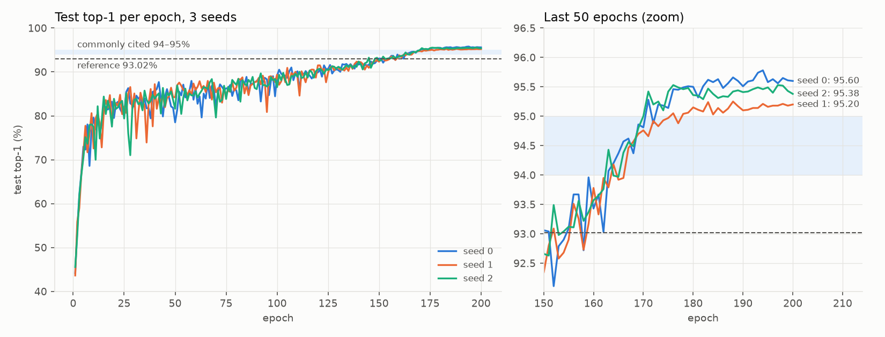
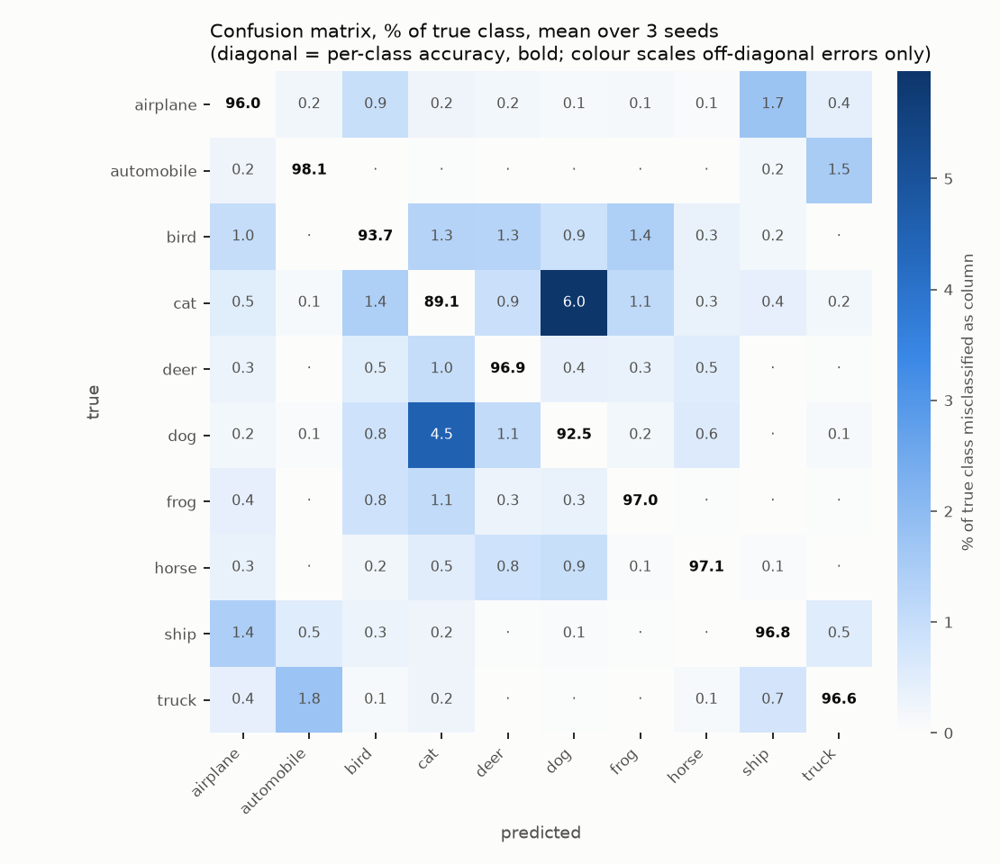

# FINDINGS: ResNet-18 on CIFAR-10, 3-seed reproduction

## What is being reproduced

**Architecture.** K. He, X. Zhang, S. Ren, J. Sun, *Deep Residual Learning for Image
Recognition*, CVPR 2016. [arXiv:1512.03385](https://arxiv.org/abs/1512.03385)

**The number.** The paper does **not** report ResNet-18 on CIFAR-10. Its CIFAR section (§4.2)
uses a different, 3-stage family (ResNet-20/32/44/56/110, 16/32/64 channels, ~0.27–1.7 M params),
and its best single number there is 6.43% error for ResNet-110. The "ResNet-18 gets ~93–95% on
CIFAR-10" figure that everyone cites comes from the community repository
[kuangliu/pytorch-cifar](https://github.com/kuangliu/pytorch-cifar). Its README lists:

| Source | Model | Reported top-1 |
|---|---|---|
| kuangliu/pytorch-cifar README | ResNet18 | **93.02%** |
| Commonly cited (blogs, papers using that code) | ResNet18 | ~94–95% |

Below, "reference" means **93.02%**, the only concrete, citable number. I also compare against
the 94–95% folk band. The README does not say which recipe or how many runs produced 93.02%, so
the reference itself has unknown variance.

## Recipe (identical to `src/repro/configs/resnet18_cifar10.yaml`)

| | Reference `main.py` | This repro |
|---|---|---|
| Model | ResNet-18, 3x3 s1 stem, no maxpool, BasicBlock [2,2,2,2] | same (own implementation, 11,173,962 params) |
| Optimizer | SGD lr 0.1, momentum 0.9, wd 5e-4 (all params) | same |
| Schedule | CosineAnnealingLR(T_max=200), stepped per epoch | same (closed form, tested equal to PyTorch's) |
| Epochs / batch | 200 / 128, last partial batch kept | same |
| Augmentation | RandomCrop(32, pad 4) + HFlip | same semantics, done on GPU (tested) |
| Normalization | mean (0.4914, 0.4822, 0.4465), std (0.2023, 0.1994, 0.2010) | mean same, std **(0.2470, 0.2435, 0.2616)** |
| Precision | fp32 | **bf16 autocast** (train only; eval in fp32) |
| Reported number | best test acc over 200 epochs | **final-epoch** test acc |
| Seeds | 1 (unseeded) | **3 (0, 1, 2), fully seeded, deterministic kernels** |

## Results

Generated by `python -m repro.report` from [`results/aggregate.csv`](results/aggregate.csv).
Do not edit by hand: `tests/test_findings_sync.py` fails if this block disagrees with the CSV.

<!-- BEGIN GENERATED:results (source: results/aggregate.csv; regenerate with `make report`) -->
| Run | Top-1 (%) | Top-5 (%) | Test loss | Best-epoch top-1 (%) ¹ | Final train acc (%) ² | Train time (h) |
|---|---|---|---|---|---|---|
| seed 0 | 95.60 | 99.83 | 0.1726 | 95.78 (ep 194) | 99.99 | 0.85 |
| seed 1 | 95.19 | 99.89 | 0.1810 | 95.25 (ep 188) | 99.99 | 0.89 |
| seed 2 | 95.38 | 99.90 | 0.1681 | 95.53 (ep 176) | 100.00 | 0.86 |
| **mean ± std (n=3)** | **95.39 ± 0.21** | 99.87 ± 0.04 | 0.1739 ± 0.0066 | 95.52 ± 0.27 | 99.99 ± 0.00 | 0.87 ± 0.02 |

- Reference (kuangliu/pytorch-cifar README, ResNet18): **93.02%**. Δ (our mean − reference) = **+2.37 pp**.
- Commonly cited band 94–95%: our mean is **above** it (+0.39 pp vs the top of the band).
- 95% CI for the mean (Student t, df=2): [94.88, 95.90]. Seed range (max − min): 0.41 pp.
- **Verdict:** 3/3 seeds beat the reference. The reference lies outside our 95% CI, so the gap is not explained by seed noise. Worst seed vs reference: +2.17 pp.
- Picking the best epoch on the test set (what the reference script checkpoints) would add **+0.13 pp** on average. We do not use it as the headline.

¹ Max over the 200 per-epoch test evaluations: an optimistic, test-set-selected number, shown only for comparison with the reference script's `best_acc`.
² Mean batch accuracy over the last epoch, on augmented training data in train mode.
<!-- END GENERATED:results -->

### Compute

<!-- BEGIN GENERATED:compute (source: results/aggregate.csv; regenerate with `make report`) -->
- Hardware: NVIDIA GeForce RTX 4060 Laptop GPU (1 GPU, runs executed sequentially); PyTorch 2.14.1+cu126
- Total GPU-hours (sum of training time over 3 seeds): **2.60**
- Wall-clock, first seed start to last seed end: **2.62 h**
- Per seed: 0.87 ± 0.02 h for 200 epochs
<!-- END GENERATED:compute -->

### Per-class accuracy (hardest first)

<!-- BEGIN GENERATED:per_class (source: results/aggregate.csv; regenerate with `make report`) -->
| Class | Top-1 (%), mean ± std over 3 seeds |
|---|---|
| cat | 89.13 ± 0.74 |
| dog | 92.53 ± 0.72 |
| bird | 93.67 ± 0.29 |
| airplane | 96.00 ± 0.70 |
| truck | 96.63 ± 0.15 |
| ship | 96.83 ± 0.67 |
| deer | 96.93 ± 0.60 |
| frog | 97.00 ± 0.53 |
| horse | 97.10 ± 0.26 |
| automobile | 98.07 ± 0.29 |
<!-- END GENERATED:per_class -->

## Interpretation

Exact numbers live in the generated blocks above. The prose below does not restate them, only
rounded descriptions, so a re-run cannot leave stale figures here.

**Bottom line.** The commonly cited ~94–95% figure **reproduces**: our mean sits just above the top of
that band, and our 95% CI overlaps it. The README's specific **93.02% does not**: every seed beats it,
and the gap is far outside our seed-to-seed noise (see the Verdict line). We beat the only
citable reference number by over 2 pp, which is a red flag, so here is the case against
ourselves:

- **Most likely explanation: the 93.02% row was produced by a weaker recipe than the one in the
  repo today** (divergence #1). The same README table lists PreActResNet18, a near-identical
  network that only reorders BN/ReLU, at 95.11%. Under one shared recipe, a +2 pp gap between
  those two architectures would be implausible. Under different recipes it would be expected.
  I can't prove this without the original logs, so it stays an inference. The control run in
  the 10x plan would settle it.
- **Test leakage? I checked and found none.** The training loop only reads the training arrays,
  and the test set enters only through `predict()` for logging and `eval.py`. A SHA-1 comparison
  finds 0 exact duplicate images between the 50k train and 10k test images. **Not** checked:
  near-duplicates. Barz & Denzler (2020, "Do We Train on Test Data? Purging CIFAR of
  Near-Duplicates") report ~3.3% of CIFAR-10 test images have near-duplicates in train. That
  inflates every CIFAR-10 number, including the reference, so it affects the absolute level but
  not our Δ.
- **Selection? None.** All 3 seeds are reported, the final epoch was fixed in advance, and
  nothing was tuned. If we had used the reference's own best-on-test checkpointing, the gap would
  only grow (the "best epoch" line in the results block).
- **Do our deviations help?** Not plausibly. bf16 and the corrected std constants are expected
  to be neutral or slightly harmful, not +2 pp helpful. They remain unablated (#3, #4).

**Variance.** Seed-to-seed spread is a few tenths of a pp (std and range in the results block).
So any single-run comparison between two CIFAR-10 recipes differing by less than ~0.5 pp is
noise, and that includes many "ours vs. theirs" tables. The per-class std is larger still, so
per-class differences under ~1 pp should not be read into. In the zoom panel of
`accuracy_curve.png`, seed 1 settles visibly lower than the others from about epoch 175. I see
no sign of a bug (same code and data, bit-reproducible). It is the kind of spread you only see
with more than one seed.

**Learning dynamics.** The test curve is noisy around ~80–90% for most of training, while the
LR is high. Most of the final accuracy arrives in the last ~50 epochs as the cosine schedule
anneals, with all seeds near ~93% at epoch 150 (see the plot). Two consequences: shortening the
schedule without rescaling `T_max` would understate the recipe badly, and the "best epoch"
always lands near the end, so best-epoch selection adds only a little here. Final training
accuracy is ~100% on augmented data, so the model fully fits the training set, and generalization
comes from augmentation plus weight decay, not from early stopping.

**Errors.** They are dominated by the cat↔dog pair: in `confusion.png`, cat→dog and dog→cat are
by far the largest off-diagonal cells, and cat is the hardest class. Then come vehicle pairs
(automobile↔truck, airplane↔ship) and bird spreading across the animal classes. This matches the
usual CIFAR-10 failure pattern and gives no hint of a pipeline bug, such as a class-index
mix-up, which would show up as a single anomalous off-diagonal block.

## What diverged and why

Each gap is marked **Resolved** (removed, or measured so it can be discounted) or **Accepted**
(still present, with the reason it is tolerable).

1. **The reference number is not a paper number, and its provenance is unclear. Accepted.**
   The ResNet paper has no ResNet-18/CIFAR-10 result (see top). The 93.02% in the kuangliu
   README comes with no recipe, seed count, or date. The README's own usage line,
   `python main.py --resume --lr=0.01`, reflects an older workflow of manual LR drops. The current
   `main.py` uses `CosineAnnealingLR(T_max=200)` instead. I could not confirm which of the two
   produced the 93.02% row. So the "reference" may come from a different recipe than the one in
   the repo today, and its variance is unknown. I can't fix that from the outside. I report Δ
   against 93.02% (the only citable figure) **and** against the 94–95% folk band.

2. **Test-set epoch selection in the reference. Resolved (measured, not adopted).** The reference
   `main.py` evaluates on the test set every epoch and saves the checkpoint with the highest
   `best_acc`. Its number is therefore a max over 200 noisy test evaluations, an optimistically
   biased estimator. Here the headline is the **final epoch**, fixed before training, so the test
   set is never used for selection. The "Best-epoch top-1" column and the "Picking the best
   epoch…" line in the generated results block measure how much that selection would have added.

3. **Normalization constants. Resolved (deliberate fix; expected effect ≈ 0, not ablated).**
   The reference normalizes with std `(0.2023, 0.1994, 0.2010)`, which is not the per-pixel std
   of CIFAR-10. I use the true train-set statistics `(0.2470, 0.2435, 0.2616)`, verified against
   the data in `tests/test_data_shapes.py`. Our inputs are a per-channel rescale of the
   reference's by factors 0.82 / 0.82 / 0.77. The first conv has no bias and feeds straight into
   BatchNorm, so a uniform rescale would be absorbed exactly. The ~6% non-uniformity on the blue
   channel only re-parameterizes `conv1` slightly. I expect no measurable effect.

4. **bf16 autocast instead of fp32. Accepted (speed vs. fidelity; not ablated).** On this laptop
   GPU, measured with the real model and batch size: bf16 31 ms/step (≈0.67 h/seed), fp32
   135 ms/step (≈2.9 h/seed, and even that "fp32" uses TF32 for convs by default). Real runs took
   longer than this synthetic benchmark (see Compute) because of augmentation, per-epoch eval,
   logging, and laptop thermals, but the ~4x ratio is what matters: fp32 would have turned 3 seeds
   into roughly 10 GPU-hours. Weights, optimizer state, the loss, and all evaluation
   stay fp32. Only the forward/backward matmuls and convs run in bf16. bf16 mixed precision is
   standard for ResNets and usually costs ≤0.1–0.2 pp, but **I have not measured it on this
   task**. That is item 2 in the 10x-compute plan.

5. **Data pipeline implementation. Resolved (semantics proven equal by test).** The reference
   uses torchvision PIL transforms in DataLoader workers. I run the same augmentation on the GPU
   so that training is not CPU-bound on Windows. `test_each_train_image_is_a_padded_crop_of_its_source_possibly_flipped`
   checks that every training image is exactly a zero-padded 32x32 crop of its source, optionally
   flipped, with the right flip rate and varied offsets. The random streams differ from
   torchvision's, so individual augmented images are not the same as the reference's, but the
   distribution is.

6. **Determinism holds per machine, not across machines. Accepted.** With a fixed seed, two GPU
   runs give bit-identical per-step logs (checked: 0 differing cells over a 158-step smoke run),
   and `tests/test_seed_determinism.py` asserts the same on CPU. But the same seed, data order,
   and weights give different trajectories on different hardware or precision. The 2-epoch smoke
   run reached 34.85% on the GPU (bf16) and 36.65% on CPU in Docker (fp32). Even the eval layout
   matters at the margin: for seed 1, the in-training epoch-200 eval (fp32, channels-last)
   logged 95.20%, while the standalone `eval.py` pass on the same weights (fp32, contiguous)
   gives 95.19%, one test image apart. The headline uses `eval.json`. So seed-to-seed variance
   is the meaningful error bar, not the exact digits of any one seed.

7. **"Validation" is the test set. Accepted (same as the reference).** There is no hold-out
   split. The per-epoch `val_*` columns are test-set numbers, exactly as in the reference script.
   They are logged for the learning curve only. No hyperparameter, epoch, or seed was chosen by
   looking at them, and all three seeds are reported.

8. **Seeds and sample size. Accepted.** The reference reports one unseeded run. Here n=3, so the
   standard deviation is itself very uncertain (the 95% χ² interval for the true σ at
   df=2 runs from 0.52x to 6.3x the estimate), and the t-based CI (df=2, t=4.30) is wide.

## What I would do with 10x compute

10x is ≈26 GPU-hours on this laptop, or a few hours on a single A100.

1. **Run a control: the unmodified `kuangliu/pytorch-cifar` `main.py`, 3 seeds, same machine.**
   This is the cleanest way to split "my implementation differs" from "the reference number is
   stale/lucky". If the control lands where we do, divergence #1 is explained.
2. **Ablate bf16 vs fp32 (TF32 off), 3 seeds each.** This closes divergence #4 with a measured
   Δ ± CI instead of an argument.
3. **10 seeds of the main config.** This tightens the CI on the mean from ±t·σ/√3 (t=4.30) to
   ±t·σ/√10 (t=2.26), roughly 3.5x narrower, and makes σ itself trustworthy.
4. **Hold out 5k training images as a real validation set**, to measure the selection bias
   from divergence #2 honestly (best-on-val vs final, both scored on test).
5. **Evaluate on CIFAR-10.1** (Recht et al., 2018). It checks whether the ~95% transfers to a
   freshly collected test set (Recht et al. report drops of roughly 4–10 pp) or partly reflects
   years of test-set reuse.
6. One-at-a-time ablations of the remaining small deviations (reference std constants; dropping
   the partial last batch), mostly to confirm they are within noise.
