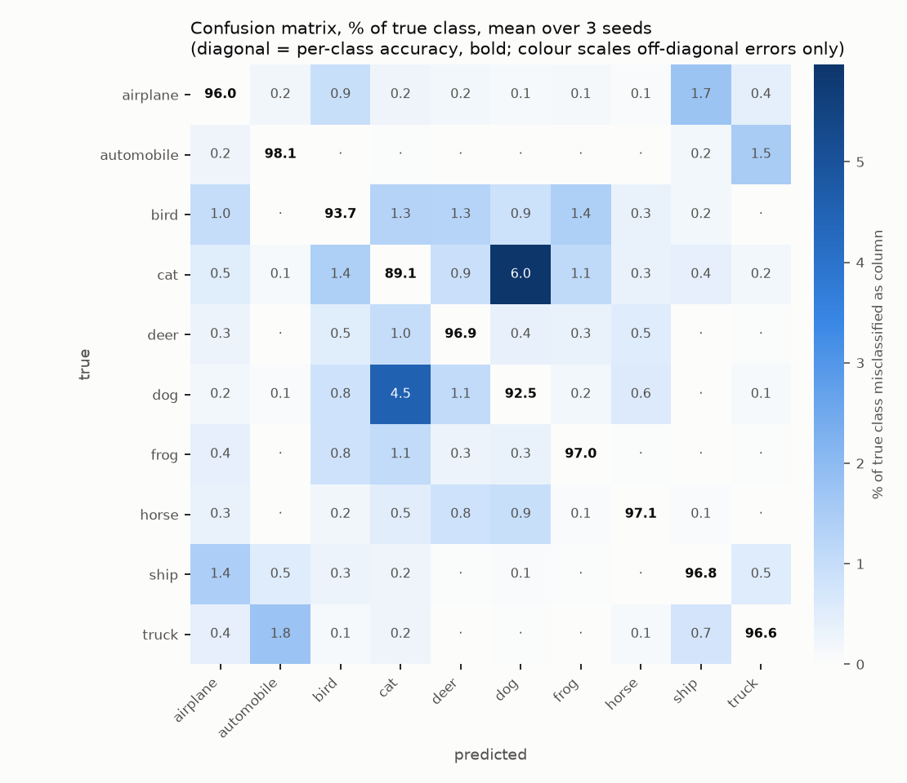

# Findings

Mean final-epoch test accuracy over three seeds is **95.39%**, 2.37 points above the 93.02% I was trying to reproduce. The reference sits outside the 95% CI, so seed noise doesn't explain the gap, and most of this file is about what might. After that come the smaller problems that showed up in CI and in the logs, and a list of things I haven't tested yet. Numbers, plots and compute are in the [README](README.md).

## The number isn't in the paper

The usual line is that ResNet-18 gets 93-95% on CIFAR-10, with He et al. (CVPR 2016, [arXiv:1512.03385](https://arxiv.org/abs/1512.03385)) as the source. It isn't there. The paper has no ResNet-18 result on CIFAR-10. Section 4.2 uses a different 3-stage family (ResNet-20, 32, 44, 56 and 110, with 16/32/64 channels and 0.27 to 1.7 M parameters), and the best single number in it is 6.43% error for ResNet-110.

The figure comes from the community repo [kuangliu/pytorch-cifar](https://github.com/kuangliu/pytorch-cifar), whose README lists ResNet18 at 93.02%. That is the only concrete, citable number, so it's my reference. I also compare against 94-95%, which is where blogs and papers using that code usually land. The README doesn't say which recipe or how many runs produced 93.02, so the reference has a variance I know nothing about.

## Beating the reference by 2 points

All three seeds finished above 93.02: 95.60, 95.19 and 95.38, mean 95.39 with std 0.21. The 95% CI is 94.88 to 95.90 (Student t at df=2, so t is 4.30), and the worst seed is still 2.17 points over. On my side, three things could explain it.

Leakage. The training loop only reads the training arrays; the test set goes through `predict()` for logging and through `eval.py`. A SHA-1 comparison of the 50k train and 10k test images found no exact duplicates. That was a one-off check and the script isn't in the repo. I did not look for near-duplicates. Barz and Denzler (2020) report that about 3.3% of CIFAR-10 test images have a near-duplicate in the training set, which inflates every CIFAR-10 number, the reference's included. It moves the absolute level and shouldn't move the difference.

Selection. None. The final epoch was fixed before training and all three seeds are reported. Picking the best epoch on the test set, as the reference script does, would have added 0.13 points on average (95.52 against 95.39), so the gap would grow.

My deviations. Training in bf16 and using the corrected normalization std (both below) should be neutral or slightly harmful. Neither plausibly buys 2 points. Neither is ablated.

That leaves the reference itself. My best guess is that 93.02 came from a weaker recipe than the one in the repo today. kuangliu's README lists PreActResNet18 at 95.11%, and that is almost the same network (it only reorders BN and ReLU). Under one recipe a 2-point gap between the two would be strange; under two different recipes it wouldn't. The README's own usage line is `python main.py --resume --lr=0.01`, which reads like an older workflow with manual LR drops, while the current `main.py` uses `CosineAnnealingLR(T_max=200)`. I can't tell which of the two produced 93.02. Without the original logs this stays a guess, and a control run would settle it (last section).

## Wrong normalization std in the reference

The reference normalizes with std (0.2023, 0.1994, 0.2010). Those aren't the per-pixel std of CIFAR-10. The training-set values are (0.2470, 0.2435, 0.2616), which is what `src/repro/configs/resnet18_cifar10.yaml` uses, and `tests/test_data_shapes.py` checks them against the data when it's on disk. Per channel, my inputs are the reference's scaled by 0.82, 0.82 and 0.77.

The first conv has no bias and feeds straight into BatchNorm, which cancels a uniform rescale of its input (up to its epsilon). The factors aren't uniform, since blue is about 6% off from the other two, so conv1 ends up slightly reparameterized. I expect no measurable effect and haven't ablated it.

## The reference picks its best epoch on the test set

The reference script evaluates on the test set every epoch and saves the checkpoint with the highest accuracy. Its number is a max over 200 noisy evaluations, so it runs high. Mine is the final epoch. The best-epoch column in the README table shows what selection would have added here: 0.13 points.

My `train_log.csv` also calls the test set "val", as the reference does, and there is no hold-out split. Those columns exist for the learning curve. No epoch, seed or hyperparameter was picked by looking at them.

## Same seed, different numbers

Determinism holds on one machine. Two GPU smoke runs with the same seed gave identical per-step logs (0 differing cells over 158 steps), and `tests/test_seed_determinism.py` asserts the same on CPU. Across hardware it breaks: the 2-epoch smoke run reached 34.85% on the GPU (bf16) and 36.65% on CPU in Docker (fp32).

To get determinism on CUDA I replaced the global average pool with `x.mean(dim=(2, 3))`, because the backward pass of `AdaptiveAvgPool2d` isn't deterministic there. Augmentation also runs on the GPU, with a CPU `torch.Generator` seeded from (seed, epoch), so DataLoader workers aren't a source of randomness either.

There is a smaller mismatch inside seed 1. The epoch-200 evaluation in the training loop (fp32, channels-last) logged 95.20%, and the standalone `eval.py` pass on the same final weights (fp32, contiguous memory) gives 95.19%, one test image apart. Seeds 0 and 2 match exactly. My guess is that the memory layout changes which kernels cuDNN picks, but I haven't isolated it. The README numbers come from `eval.json`. Seed-to-seed spread is the error bar to trust, not the last digit of any one seed.

## CI failed on the results commit

The CI run for the commit that added `results/` failed in both jobs, `test-and-smoke` and `docker`, on the same test: `tests/test_findings_sync.py` raised FileNotFoundError for `FINDINGS.md`. The test skipped itself only when `results/aggregate.csv` was missing, and that commit had the CSV but not the markdown files, which landed in the next one. The run was 16 passed, 1 failed, 1 skipped, and the next run was green. No code change was needed. I've since deleted that test along with the generated blocks it guarded.

## Things that looked wrong and weren't

Seed 1 settles lower than the other two from about epoch 175 (see the zoom panel in `results/accuracy_curve.png`). Same code, same data, bit-reproducible, so I read it as ordinary seed spread.

Errors concentrate in cat and dog. Cat to dog (6.0% of cats) and dog to cat (4.5% of dogs) are the biggest off-diagonal cells in `results/confusion.png`, and cat is the hardest class at 89.13 ± 0.74, then dog at 92.53 and bird at 93.67. Automobile against truck and airplane against ship come next. A class-index mix-up would show up as one odd off-diagonal block, and there isn't one.

The test curve is noisy between about 80 and 90% while the learning rate is high, and most of the final gain arrives in the last 50 epochs of the cosine schedule. Every seed is near 93% at epoch 150. Cutting the schedule short without rescaling T_max would probably understate what the recipe can do.

## Why training runs in bf16

The reference trains in fp32. I measured both on this laptop GPU with the real model and batch size: 31 ms/step in bf16 and 135 ms/step in fp32, and that fp32 figure already lets cuDNN use TF32 for convs by default. The full runs were slower than the benchmark (augmentation, per-epoch eval, logging, laptop thermals), but the ratio of about 4x is what mattered. From the benchmark alone, fp32 comes to roughly 2.9 h per seed, so about 9 GPU-hours for three seeds against 2.6 in bf16, and probably more once the real-run overhead is added. Weights, optimizer state, the loss and all evaluation stay fp32. I haven't measured what bf16 costs in accuracy on this task.

## Not tested yet

For scale, three seeds of the main config took 2.6 GPU-hours. In rough order of how much each item would settle:

1. The unmodified kuangliu/pytorch-cifar `main.py`, 3 seeds, same machine. If it lands near my numbers, the 93.02 was a stale or lucky figure.
2. bf16 against fp32 with TF32 off, 3 seeds each.
3. Ten seeds of the main config. That shrinks the CI half-width by about 3.5x (t drops from 4.30 to 2.26 and n goes from 3 to 10) and makes the std itself believable.
4. A 5k hold-out from the training set as a real validation split, to measure what best-epoch selection adds (best on val against final, both scored on test).
5. CIFAR-10.1 (Recht et al., 2018), a freshly collected test set, to see whether 95% holds up or partly reflects years of reuse of the original test set.
6. One-at-a-time ablations of the remaining small deviations (the reference's std constants, dropping the partial last batch), mostly to confirm they're inside the noise.
