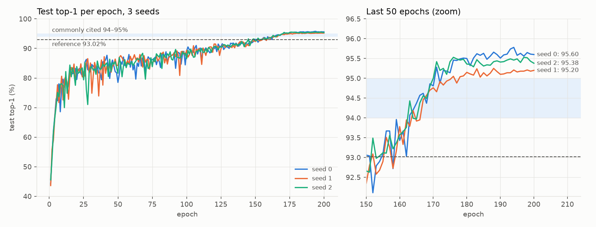

# repro-cifar10

ResNet-18 trained from scratch on CIFAR-10 with three seeds, to check the claim that it reaches 93-95% top-1. Mean test accuracy at the final epoch is **95.39 ± 0.21%**, which is above the 93.02% reference. [FINDINGS.md](FINDINGS.md) goes through why that might be.



## What was trained

The recipe is the one in kuangliu/pytorch-cifar's `main.py`: ResNet-18 with a 3x3 stride-1 stem and no max-pool, SGD with lr 0.1, momentum 0.9 and weight decay 5e-4, cosine annealing over 200 epochs, batch size 128, random crop (4 px padding) and horizontal flip. The model is my own implementation in `src/repro/model.py`. torchvision's `resnet18` only shows up in a test that compares shapes and parameter counts.

I changed four things from the reference. The normalization std uses the real CIFAR-10 values, training runs in bf16 (evaluation stays fp32), augmentation runs on the GPU, and the reported number is the final epoch instead of the best one on the test set. FINDINGS covers each. Runs are seeded, and a test checks that two short CPU runs with the same seed give bit-identical losses.

## Results

| Run | Top-1 (%) | Top-5 (%) | Test loss | Best-epoch top-1 (%) | Final train acc (%) | Train time (h) |
|---|---|---|---|---|---|---|
| seed 0 | 95.60 | 99.83 | 0.1726 | 95.78 (ep 194) | 99.99 | 0.85 |
| seed 1 | 95.19 | 99.89 | 0.1810 | 95.25 (ep 188) | 99.99 | 0.89 |
| seed 2 | 95.38 | 99.90 | 0.1681 | 95.53 (ep 176) | 100.00 | 0.86 |
| mean ± std (n=3) | **95.39 ± 0.21** | 99.87 ± 0.04 | 0.1739 ± 0.0066 | 95.52 ± 0.27 | 99.99 ± 0.00 | 0.87 ± 0.02 |

Best-epoch top-1 is the max over the 200 per-epoch test evaluations, so it is selected on the test set. It is there to compare with the reference script, which keeps the best epoch. Final train acc is the mean mini-batch accuracy over the last epoch, on augmented data with the model in train mode.

The 95% CI on the mean is 94.88 to 95.90 (Student t, df=2, so t=4.30) and the three seeds span 0.41 points. The reference's 93.02 is outside the interval.

Compute:

- Hardware: NVIDIA GeForce RTX 4060 Laptop GPU (1 GPU, runs executed sequentially); PyTorch 2.14.1+cu126
- Total GPU-hours (sum of training time over 3 seeds): 2.60
- Wall-clock, first seed start to last seed end: 2.62 h
- Per seed: 0.87 ± 0.02 h for 200 epochs

## Running it

```bash
make install   # .venv, torch and the package (CUDA wheels on Windows and Linux)
make test      # unit tests, CPU only, 10-15 s
make repro     # 3 seeds x 200 epochs, then aggregate and plot
```

`make smoke` trains 2 epochs on a 10k subset and fails if top-1 is under 20%. It's a sanity check, not a result. `make docker` builds a CPU image whose default command runs the tests, and `make docker-test` builds it and runs test and smoke inside. `make report` re-aggregates `results/`, redraws the plots and prints the tables above; it doesn't edit any markdown, so new numbers get pasted in by hand. `RESUME=1 make repro` continues after an interruption (checkpoints every 10 epochs).

On Windows, run `make` from Git Bash, since the recipes use bash. CIFAR-10 (about 170 MB) is downloaded to `data/` on first use.

## Layout

```
src/repro/model.py      ResNet-18 (CIFAR variant), written from scratch
src/repro/data.py       CIFAR-10 loading and on-device crop/flip augmentation, seeded per epoch
src/repro/train.py      training loop, per-step CSV log, seeding, resumable checkpoints
src/repro/eval.py       top-1, top-5, per-class accuracy and confusion matrix for a checkpoint -> eval.json
src/repro/report.py     aggregate.csv, the plots, and the printed tables
src/repro/configs/      the recipe, one YAML file
results/per_seed/seed_N/{train_log.csv, eval.json, meta.json}
results/{aggregate.csv, accuracy_curve.png, confusion.png}
```

`train_log.csv` has one row per optimizer step: `epoch, step, lr, train_loss, train_acc, val_loss, val_acc, wall_time`. `train_loss` and `train_acc` are for that mini-batch (augmented, train mode). `val_*` are filled on the last step of each epoch and blank elsewhere. `wall_time` is seconds since training started, read on the host without a GPU sync per step, so it is only exact on epoch-end rows. "val" is the CIFAR-10 test set, as in the reference script. I never use it to pick an epoch or a hyperparameter.

## Caveats

Three seeds is a small sample, and the CI on the mean is wide because the t critical value at df=2 is 4.3.

Training uses bf16 autocast for speed and the reference trains in fp32. I haven't ablated it.

There's no validation split. I report the final epoch, fixed before training, so the test set isn't used for selection. The per-epoch test curve is still plotted.

Everything ran on one machine with one GPU type. Determinism holds per machine, driver and library version, so a different GPU will give slightly different numbers. Model checkpoints (`*.pt`) and the dataset aren't committed.
